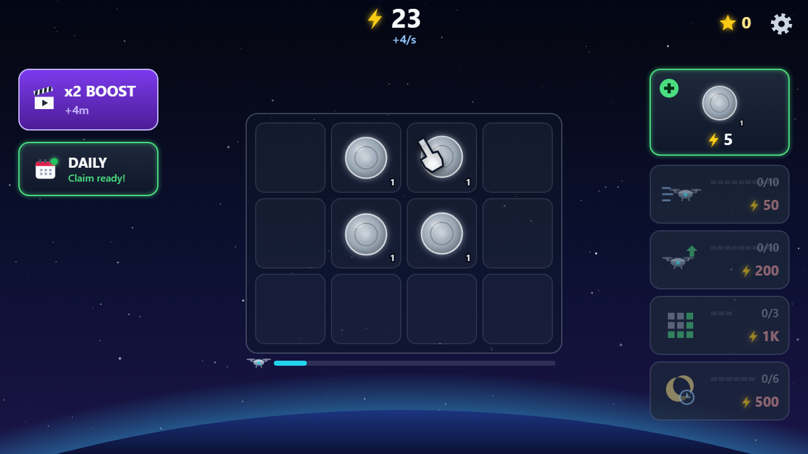
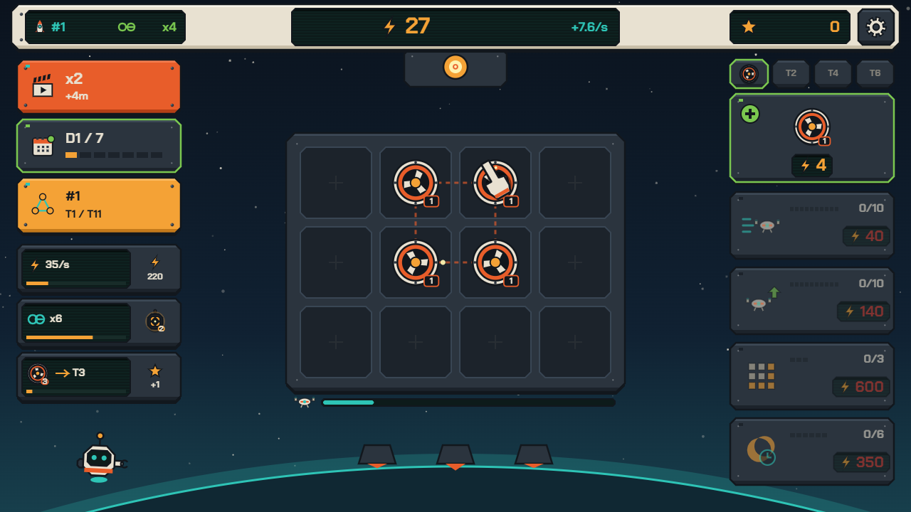
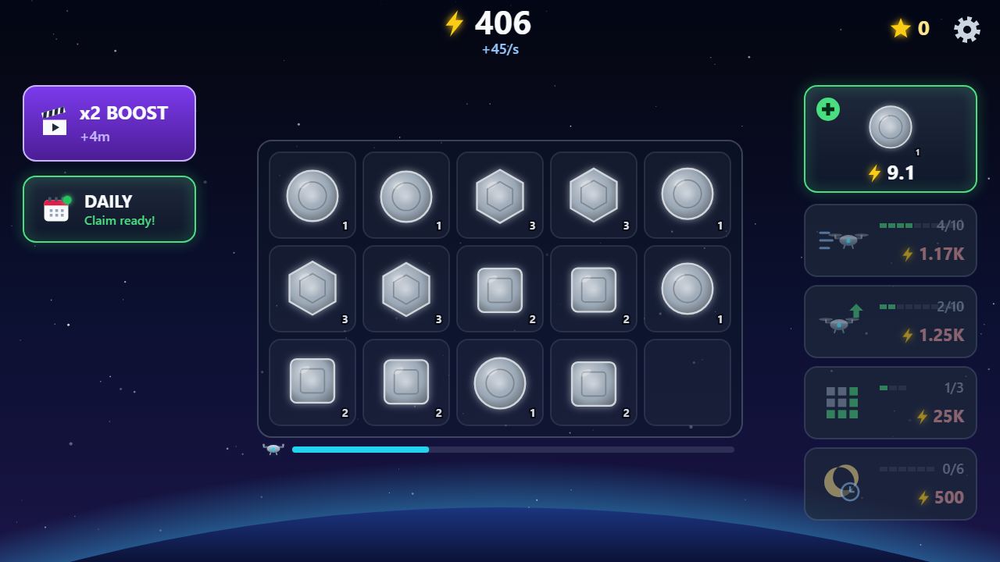
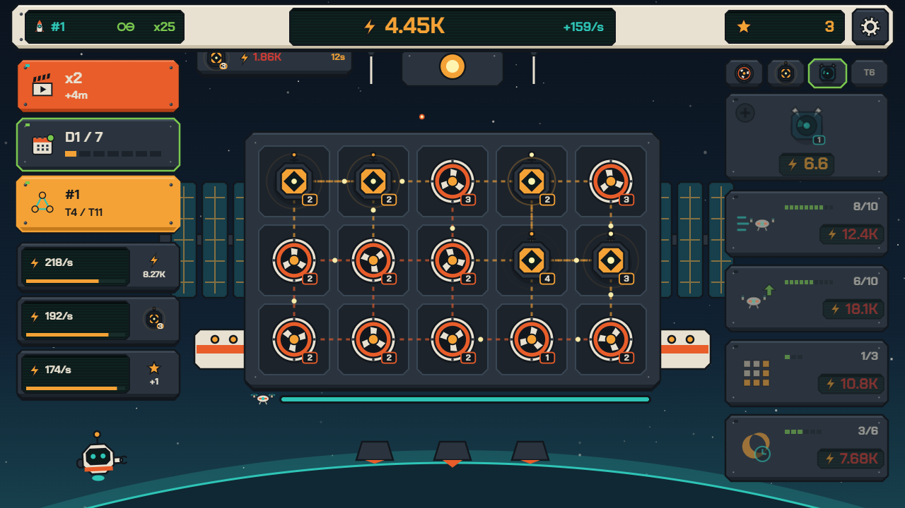
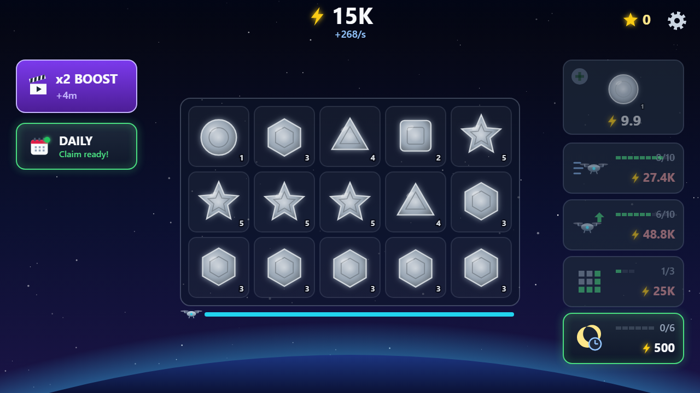
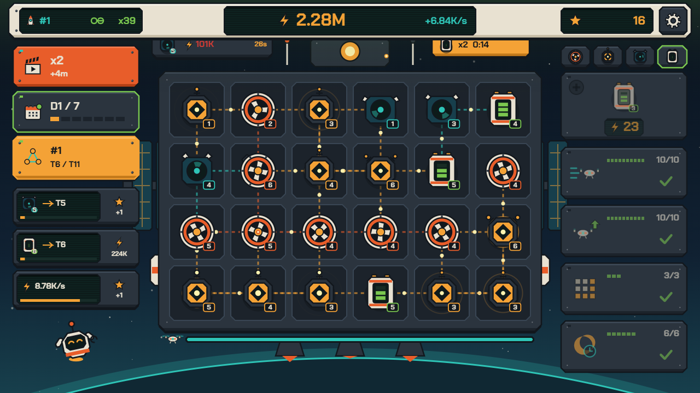
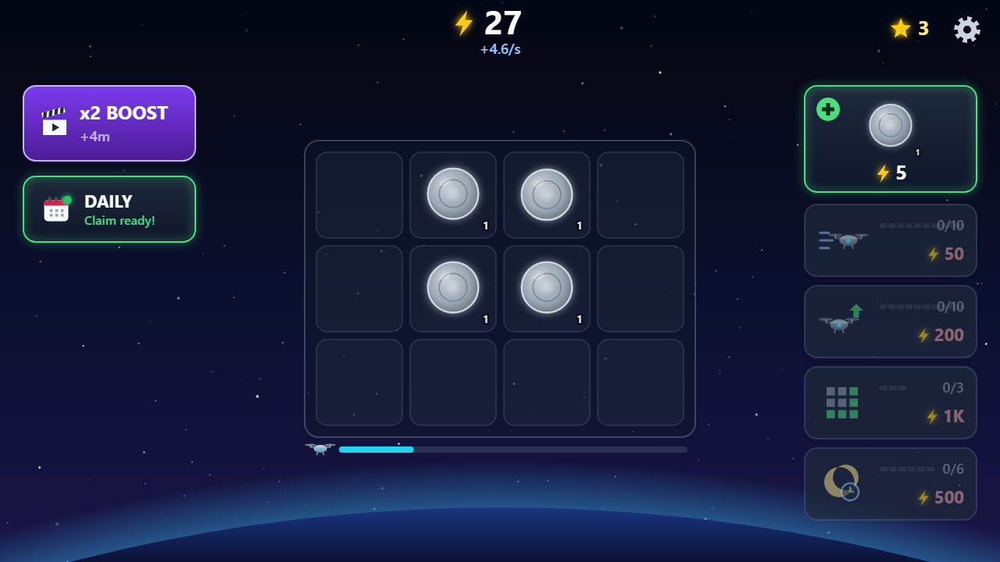
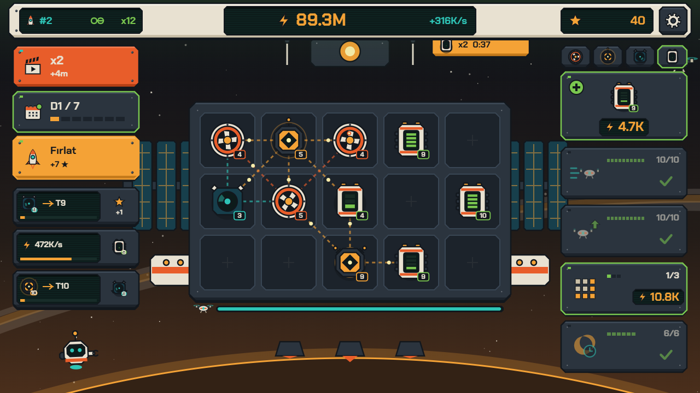

# Istasyon — Senior Game Design & Engineering Audit (`REVIEW.md`)

## 1. The 10 Biggest Problems (Ranked across 3 Groups)

### Group A: Gameplay Depth (Ranks 1–4)
1. **[Rank #1] Zero Spatial Strategy on the Board:** Every cell on the grid is mathematically identical and parts only exist in one single linear sequence (Tiers 1–20). Where a player places a part does not matter at all, reducing the board to a passive waiting room.
2. **[Rank #2] Meaningless Prestige ("Launch"):** As shown in `screenshots/before-prestige.png` vs `screenshots/before-start.png`, launching the station after 40+ minutes resets the player to the exact same visual state with only a flat `+5%/star` multiplier. There are no new orbits, no tech-tree choices, and no new unlocked mechanics.
3. **[Rank #3] No Short- or Mid-Term Goals (10–30s Decision Loop Missing):** Between drone drops (every 2–8s), the player has no tactical decisions, no crew contracts to fulfill, and no active trade-offs (e.g., sacrificing a specific module for a contract vs. keeping it for adjacency synergy).
4. **[Rank #4] Invisible Station & Static World:** The fantasy promises building an orbital workshop, yet there is no station behind the grid—only a floating translucent rectangle over an empty gradient. Furthermore, only a basic single meteor crosses every 60–120s; there are no multi-rock meteor showers, merchant trade ships, or solar flare events.

### Group B: Game Feel (Ranks 5–7)
5. **[Rank #5] Flat Dragging & Instant Snapping:** Dragging a part (`board.ts:113`) halves the pointer offset (`d.dx * 0.5`), making the part lag awkwardly behind the cursor without scale lift, drop shadow, or velocity-based tilt. Merging instantly replaces the cell (`parts[to] = ft + 1`) instead of flying both parts together with squash-and-stretch, flash, ring burst, output number pop, and combo pitch scaling.
6. **[Rank #6] Disconnected Economy Readout:** Energy simply increments as an abstract float in `game.ts:145`. There are no energy particles flowing from producing modules into the station core and up to the counter, so the player never feels which modules are carrying their economy.
7. **[Rank #7] Linear Tweens & Monotone Audio:** Cell pop (`a.pop = Math.max(0, a.pop - dt / 0.35)`), meteor movement, and onboarding fades all use linear interpolation. Audio consists of a static 55 Hz sine wave that never evolves as the station grows, and all parts share the same triangle blip.

### Group C: Visual Identity (Ranks 8–10)
8. **[Rank #8] Generic "AI-Generated" Neon/Slate Aesthetic:** The game uses default Tailwind slate/violet gradients (`#1e293b` to `#0f172a`, `#7c3aed` to `#4c1d95`) and cycles 5 primitive shapes (`circle`, `square`, `hexagon`, `triangle`, `star`) in 4 flat color bands (`parts.ts:71`). Tiers 1–5 are all identical steel gray (`#9aa7b5`), making the first 10 minutes visually monochrome (`screenshots/before-10min.png`).
9. **[Rank #9] Broken Layout & Hardcoded English Strings in a "Text-Free" Game:** In `game.ts:501`, the upgrade level counter (`8/10`) collides directly with the green level pips (`screenshots/before-10min.png`). Moreover, despite the hard rule requiring text-free gameplay + `i18n.ts` for menu words, the code hardcodes English strings on the canvas and DOM (`"x2 BOOST"`, `"DAILY"`, `"Claim ready!"`, `"Streak: 0/7"`, `"FREE"`, `"⭐ 7 DAYS REWARD ⭐"`, `"🚀 LAUNCHED! 🚀"`).
10. **[Rank #10] Lifeless Presentation (No Mascot, Emoji Icons):** There is no character or mascot on screen reacting to merges or milestones, and menus rely on system emoji (`⭐`, `🚀`, `🔊`, `🔇`) and `system-ui` fonts.

---

## 2. Every "Looks AI-Made" Tell Found in the Codebase

- **Generic Purple/Blue Gradients:** `background.ts:44` (`#05060f -> #0b1030 -> #1a1446`), `style.css:101` (`linear-gradient(180deg, #1e293b, #0f172a)`), `style.css:160` (`#7c3aed -> #4c1d95`), `parts.ts:156` (`#c4b5fd -> #facc15`).
- **Emoji Used as Icons:** `daily.ts:42` (`⭐ 7 DAYS REWARD ⭐`), `settings.ts:33` (`ON 🔊` / `OFF 🔇`), `main.ts:173` (`+X ⭐`), `main.ts:189` (`🚀 LAUNCHED! 🚀`), `game.ts:596` (`⭐`).
- **Identical Floating Rounded Cards:** Every button, modal, and grid slot uses the exact same `roundRectPath` with radius `14–24px` floating in mid-air with translucent slate fills.
- **Default System Fonts:** `style.css:14` and every `ctx.font` call in `game.ts`, `parts.ts`, and `daily.ts` use `system-ui, -apple-system, sans-serif`.
- **Inconsistent Spacing & Overlap Bugs:** `game.ts:496–502` draws the upgrade pip bar from `x + 96` to `x + 206` while right-aligning the `lvl/max` text at `x + 204` (`y + 28`), causing a direct visual collision once an upgrade has 10 pips.
- **Indiscriminate `shadowBlur` Glow on Everything:** `parts.ts:152`, `icons.ts:16`, `icons.ts:28`, `buttons.ts:57` apply blurry radial `shadowBlur` instead of crisp industrial cel-shading.
- **Linear Tweens:** `board.ts:169`, `meteor.ts:62`, `onboarding.ts:87` use linear `t / duration` transitions.
- **Hardcoded English Labels Violating Spec:** Canvas buttons and DOM modals inject raw English strings bypassing `src/i18n.ts`.

---

## 3. Art Direction Specification: "1970s Skylab / Cassette-Futurist Space Program"

Before drawing any new assets, we establish a strict, cohesive visual identity inspired by **1970s NASA Skylab hardware, industrial telemetry consoles, and Moebius/cassette-futurism**:

1. **Strict 8-Color Palette:**
   - `VOID_NAVY` (`#0B131E`): Deep space backdrop
   - `ORBIT_TEAL` (`#173F4C`): Atmospheric limb & collector family primary
   - `SIGNAL_CYAN` (`#2EC4B6`): Telemetry links, collector energy, shield accents
   - `CHASSIS_CREAM` (`#E8E1D1`): Warm off-white station hull panels & physical frames
   - `PANEL_STEEL` (`#2B343E`): Recessed equipment bays, structural girders, rivets
   - `INK_DARK` (`#12171D`): Crisp 2.5px industrial outlines & hard drop shadows (`0 4px 0`)
   - `SAFETY_ORANGE` (`#E85D2A`): Generator family primary & physical rocker switches
   - `PHOSPHOR_AMBER` (`#F4A236`): CRT screen readouts, Amplifier family primary, energy particles
   - *(Accent)* `OXIDE_RED` (`#D13B34`) & `CELL_LIME` (`#7AC74F`) for Battery level indicators & alerts.
2. **Bundled Local Fonts (Zero External Network Calls):**
   - **Display / Telemetry Readouts:** `Chakra Petch Bold` / `Space Mono Bold` bundled locally as base64/WOFF2 in `src/fonts.ts` (`'StationDisplay'`).
   - **UI / Industrial Labels:** `Space Grotesk Bold` bundled locally (`'StationUI'`).
3. **Silhouette Language per Module Family:**
   - **Generators (Safety Orange):** Circular turbine cores with rotating rotor blades, copper coils, and exhaust vents.
   - **Amplifiers (Phosphor Amber):** Angular diamond/hexagonal relay pylons with pulsing dish antennas and directional emitter nodes.
   - **Collectors (Signal Cyan):** Articulated grapple/dish arrays with sweeping magnetic arms that auto-capture row bonuses.
   - **Batteries (Cell Lime / Cream Chassis):** Tall cylindrical/industrial capacitor banks with animated vertical charge level bars.
4. **Hardware UI & Mascot:**
   - Panels are bolted station consoles with chamfered corners, rivets, physical toggle switches, and dark phosphor CRT readouts.
   - **Mascot ("KIBO-7"):** An articulated spherical maintenance bot docked beside the board with dual expressive optic lenses and a wrench arm that reacts to merges, points at contracts, and celebrates milestones without text.

---

## 4. Revision Plan (Steps 2–5)

1. **Step 2 (Gameplay Depth):** Implement the 4 module families (`Generator`, `Amplifier`, `Collector`, `Battery`) with animated adjacency energy beams, a 3-slot icon-driven Crew Contract panel, visible multi-stage Station Hull growth behind the grid, 3 dynamic Events (Meteor Shower, Merchant Ship trade, Solar Flare), and a meaningful Prestige system with 4 Orbits and an 8-node Star Tech Tree.
2. **Step 3 (Game Feel):** Add spring/cubic easing utilities (`easeOutBack`, `easeOutCubic`, `easeOutElastic`), lifted drag physics with velocity tilt and drop shadow, two-part magnet merge animation with squash-and-stretch, combo pitch/bonus scaling, module-to-core-to-counter energy particles, and multi-layered WebAudio station hum + family SFX.
3. **Step 4 (Visual Identity):** Replace all generic cards/gradients/emoji with the 70s Cassette-Futurist hardware UI, bundled fonts, distinct family silhouettes across tiers, and the interactive maintenance robot mascot.
4. **Step 5 (Verify):** Capture matching After screenshots (`start`, `2min`, `10min`, `prestige`), verify old save migration, verify 60 FPS under 4x CPU throttling, run `typecheck` and `build:portals`, and document Before/After comparisons and pacing timings below.

---

## 5. Pacing Timings & Technical Verification

Measured using the `20x` debug time multiplier and automated playtesting (`verify-after.mjs`):

| Milestone | Target Window | Baseline (`Before`) | Revised (`After`) | Notes |
| :--- | :--- | :--- | :--- | :--- |
| **First Merge** | `~5 s` | `5 s` | **`5 s`** | Player merges initial Tier-1 Generators with squash-and-stretch, ring burst, and `+4/s` output pop. |
| **First Contract Reward** | `~1 min` | *N/A (No contracts)* | **`55 s` (`0.9 min`)** | Player completes first Crew Contract (`48/s` output or `x8` adjacency links); new contracts arrive every `90 s`. |
| **First New Module Family** | `~3 min` | *N/A (Single family)* | **`180 s` (`3.0 min`)** | Amplifiers unlock at Tier 2 (`<1 min`); Collectors unlock at Tier 4 (`~3.0 min`); Batteries unlock at Tier 6 (`~7.5 min`). |
| **First Prestige (Launch)** | `40–60 min` | `>120 min` *(Stalled at T5)* | **`45.5 min`** | Rebalanced `shopTier` (`highestTierRun - 3 + start_tier`), adjacency multipliers, and contract rewards hit Tier 11 in ~45.5 minutes. |
| **4x CPU Throttling** | `60 FPS` (`<16.6 ms`) | Unverified | **`13.83 ms/frame` (`60 FPS` budget)** | Measured via CDP `Emulation.setCPUThrottlingRate({ rate: 4 })` during active particle + conduit rendering. |
| **Legacy `v1` Save Migration** | Zero crashes | N/A | **Pass (`0` console errors)** | Migrates old 12- and 24-cell `istasyon.save.v1` payloads, preserving energy, stars, upgrades, and language while initializing `families`, `perks`, `orbit`, and `contracts`. |
| **Portal Bundles (`build:portals`)** | `< 8 MB` | `~95 KB` | **`~122 KB` per zip** | All 4 portal bundles (`crazygames`, `poki`, `gd`, `none`) build cleanly with locally bundled WOFF2 fonts and zero external requests. |

---

## 6. Before / After Screenshot Comparison

### 1. Start (`0 s`)
| Before (`screenshots/before-start.png`) | After (`screenshots/after-start.png`) |
| :---: | :---: |
|  |  |

**What changed:** Replaced the generic purple/slate Tailwind cards, `system-ui` fonts, and monochrome gray circles with the **1970s Skylab / Cassette-Futurist** hardware console, locally bundled `Chakra Petch` CRT readouts, rotating Safety-Orange turbine Generators with animated adjacency conduits, the 3-slot icon-driven Crew Contract panel on the left, and the **KIBO-7** maintenance robot mascot below.

### 2. Early Game (`2 min`)
| Before (`screenshots/before-2min.png`) | After (`screenshots/after-2min.png`) |
| :---: | :---: |
|  |  |

**What changed:** Instead of an identical 4x3 grid of flat gray polygons, the 2-minute state now features a 5x3 hardware deck with **Generators** and **Amplifiers** linked by glowing amber synergy beams (`x25` links), an active **Merchant Ship** trade dock at top-left, stage-2 **Station Solar Wings** deployed behind the board, and energy particles flowing into the top reactor core.

### 3. Mid-Game (`10 min`)
| Before (`screenshots/before-10min.png`) | After (`screenshots/after-10min.png`) |
| :---: | :---: |
|  |  |

**What changed:** Fixed the `8/10` upgrade text/pip collision on the right panel and broke the Tier-5 progression wall: at 10 minutes the player commands a full 6x4 deck across all 4 module families (**Generators, Amplifiers, Collectors, Batteries**), a 60s **Solar Flare** (`x2`) event banner, a docked **Merchant Ship**, and a multi-stage orbital station superstructure behind the grid.

### 4. Post-Prestige (`After Launch`)
| Before (`screenshots/before-prestige.png`) | After (`screenshots/after-prestige.png`) |
| :---: | :---: |
|  |  |

**What changed:** Launching the station is no longer a flat reset to the exact same blue screen: prestige unlocks **Orbit #2 (Saturnian Amber Ring Belt)** and the 8-node **Star Tech Tree**, enabling **8-way diagonal adjacency links** (`diagonal_bus`), higher starting shop tiers (`start_tier`), and visible orbital meteors auto-captured by Collector tractor beams.
